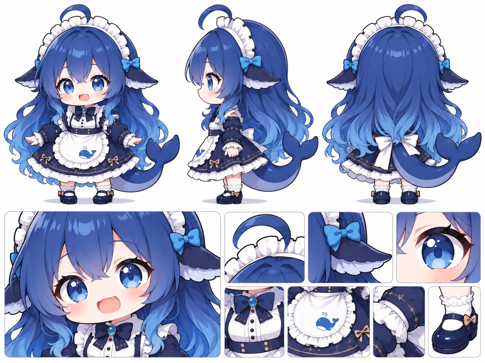

# Boss「大肥鱼」形象档案

- 名字：大肥鱼。
- 定位：本次美术设计的第一个 Boss；具体玩法与实现编号待定。
- 记录日期：2026-10-28。
- 形象基准：用户提供的设定图，原图保存为 [reference.png](reference.png)。
- 当前阶段：用户视频已接入入场、待机与幻想攻击；幻想受击后播放破灭和投掷，原盆离手后由游戏接管并飞向真实攻击植物。使用视频自带的表情和眨眼，原骨骼、眼睛形变及旧攻击画面继续隔离保留。见 [视频接入](video_v1/README.md) 与 [旧方案保留](archive/README.md)。

## 已有外观特征

- Q 版人物比例，圆脸、大眼睛，整体可爱活泼。
- 深蓝色长卷发，发梢渐变浅蓝，头顶有弯曲的呆毛。
- 蓝色眼睛，脸颊带淡粉色腮红。
- 白色褶边女仆头饰，两侧有蓝色蝴蝶结与鳍状装饰。
- 深蓝色女仆裙搭配白色围裙及多层白色褶边，局部带金色缝线和小蝴蝶结。
- 胸前为深蓝色蝴蝶结与蓝色宝石；围裙上有蓝色鲸鱼图案。
- 背后有白色大蝴蝶结和粗大的蓝色鲸鱼尾巴。
- 白色褶边短袜，深蓝色圆头鞋，鞋上带小蝴蝶结。
- 参考图包含正面、侧面、背面，以及脸部、头饰、服饰和鞋子的细节。

## 后续设计边界

- 后续造型与动作以此图为视觉依据，保持脸型、发型、服装、尾巴和配色的辨识度。
- 名字中的“大肥鱼”不自动解释为需要将角色改画成肥胖体型或纯鱼类外形。
- 逐帧待机第一版采用接近正面、略朝左的站姿，共八帧；用户反馈连播表现偏怪。
- Godot 部件版采用参考图正面站姿，九个固定贴图部件通过十二条变换轨道制作四秒循环；正式战斗朝向及其他动作随用户后续指示确定。
- 部件版已按用户反馈修正身体比例：缩短露颈、收拢双臂、压缩躯干、调整鞋袜与站距，让整体轮廓更紧凑；原始参考图保持不变。
- 已另存面向左侧的部件版：采用原图中间的左侧视角，头部、身体与鞋尖统一朝左，鲸尾与长发位于右后方；正面版继续保留。
- 当前左侧造型以用户补充的 [侧面截图](idle_left_v2/pose_reference.png)为新基准；已重画完整形象并改用五个控制骨骼制作小幅待机，上一版继续保留用于比较。
- 新增按用户照片制作的银灰色倒扣钢盆，作为独立头部配件随骨骼移动；保留未佩戴配件的基础版本。
- Boss 的游戏内体型尺寸、性格、技能和阶段变化尚未确认。
- 部件版已建立可复用的 Godot 美术场景与独立预览场景，尚未接入 Boss 战斗逻辑。

## 已生成素材

- [待机动画第一版说明](idle_v1/README.md)：包含两秒循环动图、透明帧图、规则精灵表与生成提示词。
- [Godot 部件版待机说明](idle_godot_v1/README.md)：包含可运行场景、实际引擎录制预览、部件来源及调整方法。
- [Godot 左侧待机说明](idle_left_v1/README.md)：包含左向角色场景、四秒待机动图与生成记录。
- [按新侧面参考重画的骨骼待机](idle_left_v2/README.md)：当前左向预览版本，包含新参考、完整透明图、原生骨骼场景与实际运行录像。
- [钢盆头部配件](steel_basin_v1/README.md)：当前常用左向入口展示的外观，包含参考照片、透明配件、实际预览及生成提示词。
- [取盆幻想与受击丢盆](basin_actions_v1/README.md)：保留用户钢盆位置及比例，新增四个动作关键姿势、米饭幻想气泡与攻击者定向抛盆的独立 Godot 预览；取盆图已按用户红框修正多余手臂。
- [图鉴与开发者召唤接入](game_integration.md)：入口、暂定战斗参数、反击来源、真实游戏预览和当前边界。
- [自然待机](natural_idle.md)：八秒呼吸循环、发尾延迟跟随及双脚固定的端盆骨骼待机。
- [普通待机重制与全动作眨眼](blink_v4/README.md)：当前版本，替换旧遮眼图层，含五种姿势的真实眼睑关键帧、普通待机与攻击动作1的区分。
- [小俏皮眨眼待机](idle_v3/README.md)：当前默认的站立待机，十二秒三层表演，含自然眨眼、尾鳍点两下、歪头偷瞄与钢盆回正；含可复现脚本与实际录制。
